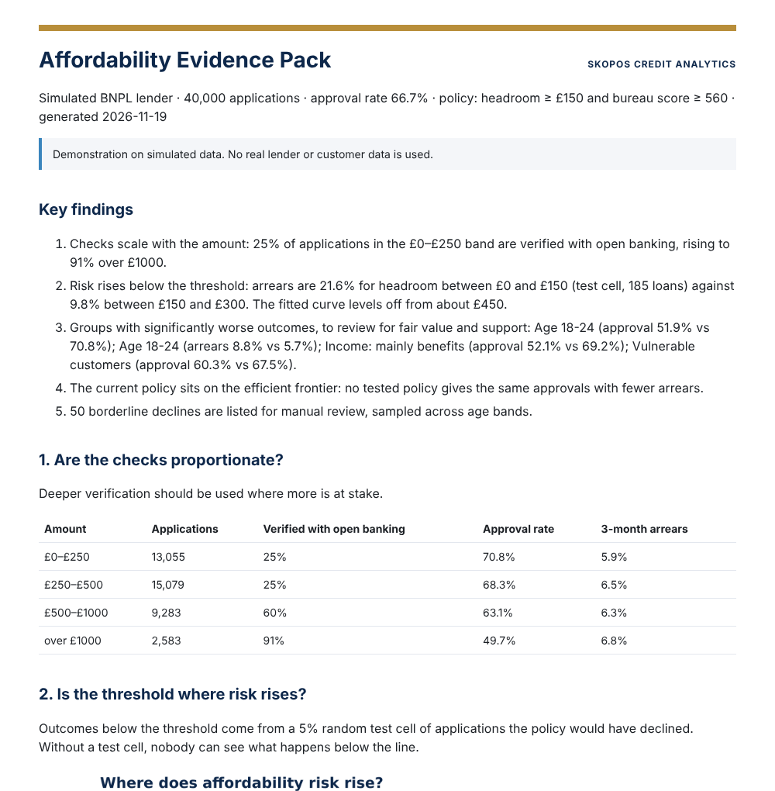
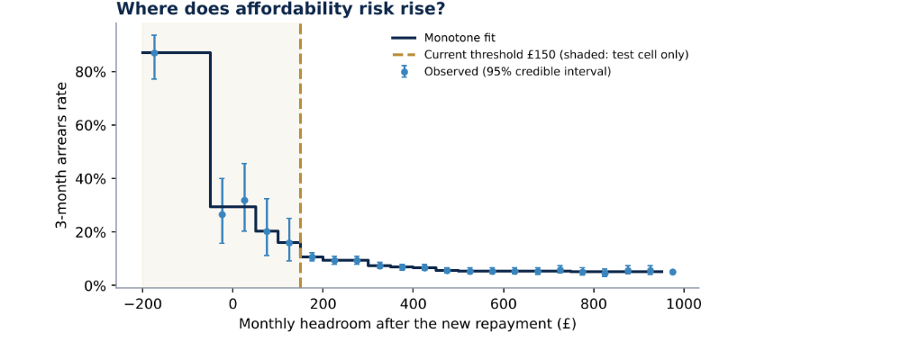

# Affordability Evidence Pack


Since 15 July 2026, buy now pay later lenders in the UK must carry out proportionate affordability checks before lending. The FCA does not prescribe a method, so each lender has to show that its own approach is sensible and evidenced. This toolkit turns application and outcome data into a single evidence pack that answers the questions a board, an auditor or the regulator is likely to ask.

> All examples use **simulated data**. No real lender or customer data is included. The pack supports a firm's own assessment; it is not legal or regulatory advice.



## The five questions it answers

| # | Question | How |
| --- | --- | --- |
| 1 | **Are the checks proportionate?** | Verification depth (for example open banking versus bureau only), approval and arrears by loan amount |
| 2 | **Is the threshold where risk rises?** | Arrears by monthly headroom after the new repayment, with Bayesian intervals and a monotone fit. Below the threshold it uses a random **test cell** of would-be declines, the only honest way to see what happens below the line |
| 3 | **Do outcomes differ across customer groups?** | Approval and arrears for each group against everyone else, flagged only when the gap is significant after multiple-comparison correction **and** material |
| 4 | **What would a policy change cost?** | Every headroom and score rule on a grid, scored by an arrears model, plotted as an **approval versus arrears frontier**. It shows whether the current policy is efficient or whether another mix of rules keeps approvals with fewer arrears |
| 5 | **Which declines deserve a second look?** | A sample of borderline declines across age bands, exported for manual review |



## Quick start

```bash
pip install -r requirements.txt
make demo     # writes examples/affordability_evidence_pack.html and borderline_declines.csv
make test
```

On your own data:

```bash
PYTHONPATH=src python -m affordability.cli --data applications.csv \
  --min-headroom 150 --min-score 560 --test-cell-rate 0.05
```

The CSV needs one row per application: `application_id`, `decision` (`approve`, `approve (test cell)` or `decline`), `arrears_3m` (blank when not lent), `headroom`, `bureau_score`, `income_volatility`, `vulnerable`, `amount`, `verification`, `age_band` and `income_type`.

## Method notes

- **Intervals:** Jeffreys (Bayesian) intervals, which behave well with few arrears.
- **Group tests:** two-proportion z-tests with Benjamini-Hochberg correction, plus a 2-point materiality threshold.
- **Headroom curve:** isotonic regression, so risk can only fall as headroom rises.
- **Frontier:** spline logistic regression trained on approved loans and the test cell, with the test cell weighted by the inverse of its sampling rate so it stands for all declines.
- **Without a test cell,** outcomes below the threshold cannot be observed. The frontier is then only reliable for policies **stricter** than today's.

## Limits

- The pack does not decide what is "proportionate" or "fair". It gives decision-makers the evidence to judge it.
- Group comparisons are descriptive. A gap is a prompt to review pricing, support and the decision rules, not proof of unfair treatment.

---

Built by [Skopos Credit Analytics](https://www.linkedin.com/company/skopos-credit-analytics): fixed-price credit model health checks for UK and DACH lenders.
